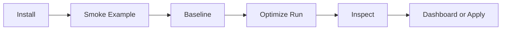

# Quickstart

This guide gets JOULE running locally and walks through a complete baseline-to-run-to-inspect workflow.

## Flow



## 1. Install

```bash
make install-dev
```

This creates `.venv` and installs editable development dependencies.

## 2. Verify End-To-End Setup

```bash
make smoke-example
```

Smoke test runs:

1. `doctor`
2. `baseline`
3. `run`
4. `inspect`
5. `dashboard --once`

## 3. Run Baseline On The Example Project

```bash
./joule baseline \
  example/mock_repo/sample_pkg/algos.py \
  --function membership_total \
  --tests tests/test_algos.py::test_membership_total \
  --hotspots \
  --output json \
  --no-dashboard
```

## 4. Run Optimization

```bash
./joule run \
  example/mock_repo/sample_pkg/algos.py \
  --function optimization_surface_demo \
  --tests tests/test_algos.py::test_optimization_surface_demo \
  --budget 6 \
  --analysis \
  --output human \
  --no-dashboard
```

CI-oriented run:

```bash
./joule run \
  example/mock_repo/sample_pkg/algos.py \
  --function optimization_surface_demo \
  --tests tests/test_algos.py::test_optimization_surface_demo \
  --ci
```

## 5. Inspect And Resume

Inspect run details:

```bash
./joule inspect example/mock_repo --run-id <run_id>
```

Resume an optimize run:

```bash
./joule resume example/mock_repo --run-id <run_id> --budget 10
```

## 6. Review Transformations And Config

```bash
./joule transformations example/mock_repo --output human
./joule config show example/mock_repo --output json
```

## 7. Dashboard Snapshot Or Server

Print snapshot once:

```bash
./joule dashboard example/mock_repo --once
```

Serve interactive page:

```bash
./joule dashboard example/mock_repo --host 127.0.0.1 --port 8501
```

## 8. Apply A Candidate (Optional)

```bash
./joule apply example/mock_repo --run-id <run_id>
```

Use `--branch` and `--commit` for SCM workflows.

Dependency-bearing candidates remain review-only and are intentionally refused by apply.

## 9. Artifact Layout

```text
<project>/
├── .joule.lock
└── .joule/
    ├── joule.db
    └── runs/
        └── <run_id>/
            ├── baseline.json
            ├── baseline_analysis.json
            ├── run_summary.json
            ├── optimization_analysis.json
            ├── hotspots.json
            ├── events.jsonl
            ├── dashboard.html
            ├── checkpoint.json
            ├── best.patch
            ├── best_candidate.py
            └── candidates/
                └── <candidate_id>/
                    ├── candidate.json
                    └── candidate.py
```

Artifact lookup by question: [docs/ARTIFACTS.md](docs/ARTIFACTS.md)

## 10. Choose The Right Workload

- Use explicit selectors for async/stateful targets.
- Use heuristic discovery for simple conventional pytest layouts.
- Use default-arg fallback only for safe pure targets.

## 11. Next Docs

- [README.md](README.md)
- [docs/ARCHITECTURE.md](docs/ARCHITECTURE.md)
- [docs/TRANSFORMATIONS.md](docs/TRANSFORMATIONS.md)
