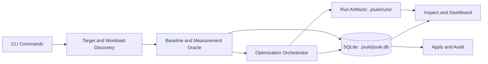

# JOULE

JOULE is a local-first Python optimization toolkit for measuring refactor candidates against energy, latency, and memory while preserving correctness.

It is designed for practical, inspectable optimization work on scoped Python targets. Every run is persisted in SQLite and mirrored into human-readable artifacts.

## Architecture At A Glance



## Quick Start

```bash
make install-dev
make smoke-example
```

Smoke test covers doctor, baseline, run, inspect, and dashboard-once using [example/mock_repo](example/mock_repo).
The example suite now includes medium and very large complex targets documented in [docs/EXAMPLES.md](docs/EXAMPLES.md).

## Command Map

| Command | Purpose | Notes |
|---|---|---|
| `doctor` | Validate runtime and backend readiness | Split required vs optional checks |
| `config show` | Show resolved configuration | Includes profile overrides |
| `discover` | Find target candidates in a project | Includes workload provenance hints |
| `transformations` | Show active operator catalog | Human or JSON output |
| `baseline` | Measure baseline for one target | Optional hotspots |
| `run` | Full optimization flow | Supports `--analysis`, `--ci`, `--fresh-surrogate` |
| `resume` | Resume an optimize run | Loads persisted run + checkpoints |
| `inspect` | Inspect persisted run state | Candidate, measurement, event, hotspot visibility |
| `dashboard` | Serve or print run dashboard HTML | `--once` for stdout snapshot |
| `apply` | Apply accepted candidate | Hash-protected and dependency-policy guarded |
| `parse-json` | Humanize JSON command output | Useful in CI pipelines |

## Core Contracts

Current code enforces typed/explicit contracts in key architecture seams:

- Backend capability contract is explicit in protocol form:
  - `EnergyBackend.name`
  - `EnergyBackend.supports_parallel_measurement`
  - `EnergyBackend.measure(...)`
- Candidate metadata is centralized and versioned:
  - `schema_version` for candidate metadata payloads
  - `schema_version` for surrogate decision payloads
- Search event detail payloads are versioned with `schema_version`.
- `MeasurementReport` now has canonical model-layer deserialization via `from_record`.

## Workload Strategy

Use explicit workload selectors whenever possible:

1. Target needs setup/state/fixtures/async orchestration: use `--tests`, `--properties`, or `--harness`.
2. Conventional pytest layout and naming: heuristic discovery may be enough.
3. No tests available: default-arg fallback is allowed only for safe pure targets.

Optimization quality is bounded by workload realism.

## Outputs And Artifacts

Each run writes to the project artifact directory (default `.joule/`).

Important outputs:

- `.joule.lock`
- `.joule/joule.db`
- `.joule/runs/<run_id>/baseline.json`
- `.joule/runs/<run_id>/baseline_analysis.json`
- `.joule/runs/<run_id>/run_summary.json`
- `.joule/runs/<run_id>/optimization_analysis.json`
- `.joule/runs/<run_id>/events.jsonl`
- `.joule/runs/<run_id>/dashboard.html`
- `.joule/runs/<run_id>/checkpoint.json`
- `.joule/runs/<run_id>/best.patch`
- `.joule/runs/<run_id>/best_candidate.py`
- `.joule/runs/<run_id>/candidates/<candidate_id>/...` when analysis is enabled

Detailed lookup guide: [docs/ARTIFACTS.md](docs/ARTIFACTS.md)

## Current Scope

In scope:

- top-level functions, async functions, and class methods
- explicit and heuristic workload resolution
- iterative Pareto-parent search with bounded depth
- local persistence and artifact-based inspection
- review-first dependency policy during apply

Not in scope for current v0:

- automatic dependency installation or manifest edits
- distributed orchestration
- fully autonomous repo-wide optimization

## Documentation Map

- [QUICKSTART.md](QUICKSTART.md)
- [docs/ARCHITECTURE.md](docs/ARCHITECTURE.md)
- [docs/ARTIFACTS.md](docs/ARTIFACTS.md)
- [docs/EXAMPLES.md](docs/EXAMPLES.md)
- [docs/TRANSFORMATIONS.md](docs/TRANSFORMATIONS.md)
