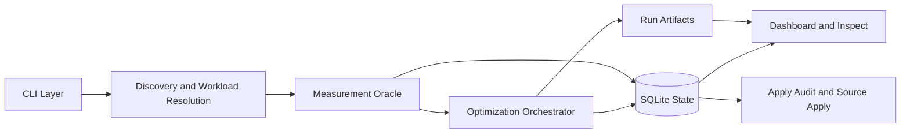
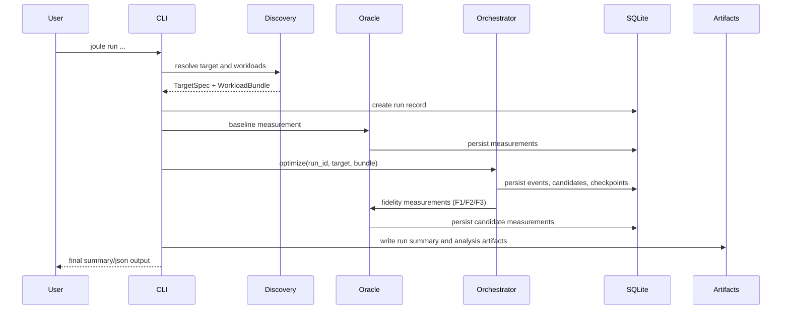

# Architecture And Design

This document describes JOULE architecture as implemented in the current codebase.

## 1. System View

Core principle: local-first, artifact-driven, and inspectable.

## 2. End-To-End Run Sequence

## 3. Subsystems

### CLI and Command Orchestration

Primary entrypoint: [src/joule/cli.py](../src/joule/cli.py)

Responsibilities:

- bootstrap settings, DB, and reporting
- expose command surface (`doctor`, `baseline`, `run`, `resume`, `inspect`, `apply`, `discover`, `dashboard`, `transformations`, `config show`, `parse-json`)
- coordinate output mode and CI semantics

### Discovery and Targeting

Primary files:

- [src/joule/discovery/resolver.py](../src/joule/discovery/resolver.py)
- [src/joule/discovery/workloads.py](../src/joule/discovery/workloads.py)
- [src/joule/discovery/profiler.py](../src/joule/discovery/profiler.py)
- [src/joule/discovery/synthesizer.py](../src/joule/discovery/synthesizer.py)
- [src/joule/discovery/purity.py](../src/joule/discovery/purity.py)

Responsibilities:

- resolve supported targets (top-level functions, async functions, class methods)
- enforce purity and scope guards
- resolve explicit workloads first, then heuristic alignment, then safe fallback

### Runtime and Correctness

Primary files:

- [src/joule/runtime.py](../src/joule/runtime.py)
- [src/joule/profiling/core.py](../src/joule/profiling/core.py)
- [src/joule/runtime_helpers/worker.py](../src/joule/runtime_helpers/worker.py)
- [src/joule/evaluators/correctness.py](../src/joule/evaluators/correctness.py)

Responsibilities:

- subprocess workload execution
- overlay materialization for candidate correctness checks
- profile payload extraction for hotspot analysis
- shared workload execution utilities (`load_object`, `execute_workload`)

### Measurement and Backends

Primary files:

- [src/joule/evaluators/oracle.py](../src/joule/evaluators/oracle.py)
- [src/joule/evaluators/backends/base.py](../src/joule/evaluators/backends/base.py)
- [src/joule/evaluators/backends/mock.py](../src/joule/evaluators/backends/mock.py)
- [src/joule/evaluators/backends/rapl.py](../src/joule/evaluators/backends/rapl.py)

Responsibilities:

- calibration and repeated sampling
- fidelity-stage measurement orchestration
- backend abstraction and capability-aware execution strategy

### Optimization Engine

Primary files:

- [src/joule/orchestrator/mfbo.py](../src/joule/orchestrator/mfbo.py)
- [src/joule/orchestrator/internal/mfbo_flow.py](../src/joule/orchestrator/internal/mfbo_flow.py)
- [src/joule/orchestrator/pareto.py](../src/joule/orchestrator/pareto.py)
- [src/joule/surrogate/facade.py](../src/joule/surrogate/facade.py)
- [src/joule/surrogate/registry.py](../src/joule/surrogate/registry.py)
- [src/joule/transformers/registry.py](../src/joule/transformers/registry.py)

Responsibilities:

- iterative Pareto-parent expansion
- operator ranking and generation
- correctness and surrogate gating
- multi-fidelity promotion and acceptance logic
- checkpointing and resume support

### Persistence and Reporting

Primary files:

- [src/joule/utils/db.py](../src/joule/utils/db.py)
- [src/joule/utils/analysis.py](../src/joule/utils/analysis.py)
- [src/joule/dashboard/app.py](../src/joule/dashboard/app.py)

Responsibilities:

- durable run-state storage in SQLite
- analysis summarization and report shaping
- dashboard rendering from persisted state

## 4. Typed Contracts And Schema Boundaries

### Backend capability contract

`EnergyBackend` is explicit and typed:

- `name: str`
- `supports_parallel_measurement: bool`
- `measure(...) -> BackendMeasurement`

This makes parallel scheduling semantics predictable for built-in and plugin backends.

### Metadata contract

Versioned metadata models are centralized in [src/joule/metadata.py](../src/joule/metadata.py):

- `CandidateMetadata`
- `SurrogateDecision`
- `versioned_event_detail(...)`

Schema versions:

- `CANDIDATE_METADATA_SCHEMA_VERSION`
- `SURROGATE_DECISION_SCHEMA_VERSION`
- `SEARCH_EVENT_DETAIL_SCHEMA_VERSION`

### Measurement serialization contract

`MeasurementReport` has canonical serialization/deserialization in [src/joule/models.py](../src/joule/models.py):

- `to_record()`
- `from_record(...)`

This removes duplicate deserialization logic across subsystems.

## 5. Data And Artifact Model

Persistent state in SQLite includes:

- runs, workloads, candidates, measurements
- search events, hotspot profiles, checkpoints
- surrogate observations, apply audits, operator stats

Human-facing artifacts include:

- run summary and analysis files
- events timeline (`events.jsonl`)
- dashboard snapshot (`dashboard.html`)
- patch and candidate packs

See [docs/ARTIFACTS.md](ARTIFACTS.md) for artifact triage guidance.

## 6. Design Tradeoffs

- Local-first execution improves reproducibility and debuggability but limits horizontal scalability.
- Explicit workloads improve validity of optimization claims but increase setup burden.
- Review-first dependency policy improves safety but blocks fully automatic apply for dependency-bearing candidates.
- Lightweight dashboard favors portability over richer interaction.

## 7. Known Constraints

- Heuristic test alignment is useful but imperfect.
- Purity checks are static and conservative.
- Search depth and composition breadth are intentionally bounded.
- Persistence writes are still mostly per-operation rather than transaction-grouped per full candidate lifecycle.

## 8. Seeing It In Action

Use the example docs to map architecture concepts to concrete runs:

- [QUICKSTART.md](../QUICKSTART.md) for baseline and optimization command flow.
- [docs/ARTIFACTS.md](ARTIFACTS.md) for run-state triage and artifact interpretation.
- [docs/EXAMPLES.md](EXAMPLES.md) for target complexity tiers and workload selectors.

## 9. Related Docs

- [README.md](../README.md)
- [QUICKSTART.md](../QUICKSTART.md)
- [docs/ARTIFACTS.md](ARTIFACTS.md)
- [docs/EXAMPLES.md](EXAMPLES.md)
- [docs/TRANSFORMATIONS.md](TRANSFORMATIONS.md)
