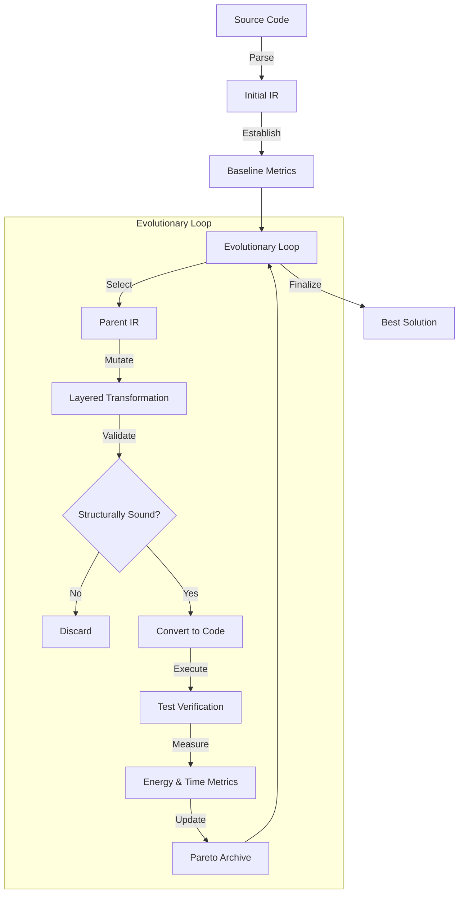

# HEDGE Architecture

HEDGE (**Hierarchical Evolutionary Darwin-Green Engine**) is a high-performance code optimization system built on a formal Intermediate Representation (IR). The system follows a modular, layered design that separates domain logic from application workflows and infrastructure concerns.

## Core Design Principles

1. **IR-Centricity**: All code transformations and analyses are performed on a strictly typed Intermediate Representation, ensuring structural validity and type safety.
2. **Hierarchical Optimization**: Strategies are organized into logical layers, from high-level semantic shifts to low-level micro-optimizations.
3. **Multi-Objective Evolution**: The engine optimizes for both execution time and energy efficiency, maintaining a Pareto-optimal archive of solutions.
4. **Validation-First**: Every mutation is validated against the IR schema and verified through automated test suites before being accepted into the population.

## High-Level Architecture

HEDGE is organized into three primary layers, following Domain-Driven Design principles:

### 1. Domain Layer (`src/domain/`)
The core of the system, containing the unified IR schema and base interfaces.
- **IR Schema**: Pydantic-based models for Python constructs (`Module`, `FunctionDef`, `Assign`, etc.).
- **IR Metrics**: Logic for calculating complexity, depth, and other static metrics.
- **Interfaces**: Abstract base classes for mutators, runners, and LLM clients.

### 2. Application Layer (`src/application/`)
Orchestrates the optimization process and implements transformation logic.
- **Evolutionary Engine**: Manages the population, selection, and reproduction cycles.
- **Mutation Hierarchy**:
    - **Semantic Layer**: LLM-guided algorithmic shifts and intent-aware refactoring.
    - **Algorithmic Layer**: Data structure optimization and complexity reduction.
    - **Syntactic Layer**: Pythonic idioms and pattern-based improvements.
    - **Micro Layer**: Localized optimizations like constant folding and dead code elimination.
- **Registry & Selection**: Intelligent mutator discovery and performance-based adaptive selection.

### 3. Infrastructure Layer (`src/infrastructure/`)
Handles interactions with external systems and the physical environment.
- **Parsing & Codegen**: High-fidelity conversion between Python source and HEDGE IR.
- **Execution Environment**: Sandbox for running code and measuring energy (via CodeCarbon) and latency.
- **LLM Clients**: Typed interfaces for OpenAI and Google Gemini APIs.

## The Optimization Pipeline

The HEDGE optimization cycle follows a structured workflow:

## Performance Measurement

HEDGE evaluates solutions based on:
- **Execution Latency**: Wall-clock time of the test suite execution.
- **Energy Consumption**: Measured in Joules/kWh using hardware sensors or estimations.
- **Code Complexity**: Static analysis of the IR (Cyclomatic complexity, nesting depth).

---
*For more details on specific layers, see [MUTATORS.md](MUTATORS.md).*
