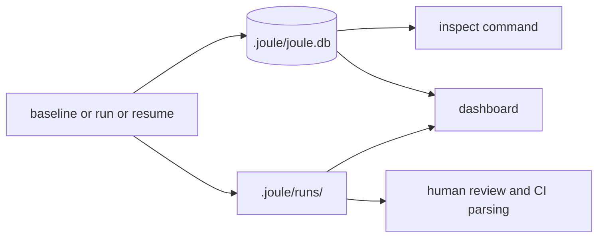

# Artifacts Guide

This guide answers: where should I look first when something succeeds, fails, or behaves unexpectedly?

## Granular Hotspot Analysis

Joule supports optional granular (line-level) hotspot profiling using `line_profiler`. This provides detailed insights into specific code blocks (loops, branches, comprehensions) within the target function.

### Two Profiling Levels

1. **BASIC** (default): Function-level profiling with cProfile
   - Hotspots by function ownership (project, stdlib, external)
   - Signal quality metrics
   - Harness summary

2. **GRANULAR**: Deep line-level profiling with `line_profiler`
   - Code block metrics (loops, branches, comprehensions)
   - Stable block IDs
   - Structured insights (not emoji strings)
   - Raw line-level timings

### Enabling Granular Profiling

Add to your `pyproject.toml`:

```toml
[tool.joule]
granular_hotspot_analysis = true
```

Or install with the profiling extra:

```bash
pip install joule-optimizer[profiling]
```

## Artifact Flow



## Quick Lookup By Question

| Question | First place to check | Follow-up |
|---|---|---|
| Did a run initialize correctly? | `.joule.lock` | `.joule/runs/<run_id>/events.jsonl` |
| What was measured as baseline? | `baseline.json` | `baseline_analysis.json` |
| Why was a candidate rejected? | `inspect --candidate-id ...` | `events.jsonl` and candidate metadata |
| Why was a candidate accepted? | `run_summary.json` candidate list | `events.jsonl` promotion and acceptance events |
| Is hotspot data target-focused enough? | `hotspots.json` `signal_quality` and `recommendations` | `by_workload` signal shares and ownership buckets |
| What changed for best candidate? | `best.patch` | `best_candidate.py` and `run_summary.json` |
| What happened in optimization flow? | `optimization_analysis.json` | `events.jsonl` |
| Can this candidate be applied? | candidate metadata `dependency_policy_state` | `apply` command response |
| Can I resume safely? | `checkpoint.json` and DB checkpoints | `resume --run-id ...` |
| Did a batch run process all targets? | Terminal output | `joule dashboard` to view all recent runs |

## Key Files Per Run

- `baseline.json`: full baseline measurement payload
- `baseline_analysis.json`: baseline summary and optional hotspot summary
- `run_summary.json`: high-level outcome with CI-oriented fields
- `optimization_analysis.json`: funnel, operator, and hotspot analysis
- `events.jsonl`: structured event timeline
- `dashboard.html`: static dashboard snapshot
- `checkpoint.json`: latest checkpoint payload for resumed runs
- `best.patch`: diff for best accepted candidate
- `best_candidate.py`: source for best accepted candidate
- `candidates/<candidate_id>/candidate.json`: per-candidate details (analysis mode)
- `candidates/<candidate_id>/candidate.py`: candidate source snapshot (analysis mode)

## Metadata And Schema Versions

Versioned fields to be aware of:

- candidate metadata includes `schema_version`
- surrogate decision payload includes `schema_version`
- search event detail payload includes `schema_version`

When parsing artifacts programmatically, read schema versions first and treat unknown fields as forward-compatible extensions.

## Recommended Inspection Sequence

1. Read `run_summary.json`.
2. If result is unexpected, open `optimization_analysis.json`.
3. Check `events.jsonl` for stage-level warning and rejection context.
4. Use `inspect --run-id ... --output json` for complete persisted state.
5. Review `best.patch` before any apply operation.

## Accepted vs Rejected Candidate Signals

Use these fields first when triaging candidate outcomes:

- `run_summary.json` candidate records for top-level acceptance status and selected winner.
- `events.jsonl` for stage-level transitions (screened, measured, promoted, rejected).
- `candidates/<candidate_id>/candidate.json` in analysis mode for per-candidate metadata.

Common checks:

- Candidate marked rejected in `run_summary.json` but unclear why: inspect matching candidate events.
- Candidate promoted but not final winner: compare scalar improvements and frontier state.
- Candidate appears apply-ready: confirm dependency policy state before calling apply.

## Hotspot Signal Triage

When reading `hotspots.json`, use these fields in order:

1. `signal_quality`: check `project_share`, `target_share`, and `low_signal` first.
2. `recommendations`: concrete next-step guidance for improving target attribution.
3. `by_workload`: per-workload `project_share`/`target_share` to find noisy selectors.
4. `target_top_functions`: target-file hotspots with share and average per-call cost.

Quick interpretation guide:

- `target_share < 0.20`: hotspot signal is likely diluted by harness/setup overhead.
- dominant owner is not `project` or `candidate-overlay`: optimize workload scope before code rewrites.
- empty `target_top_functions`: target may not be exercised strongly enough in current workload set.

## Granular Analysis Structure (Schema v2)

When `granular_analysis` is present in `hotspots.json` (GRANULAR level):

### Code Blocks

Each block has:
- `block_id`: Stable identifier based on file, function, line range, and type
- `type`: Block type (e.g., `for_loop`, `if_branch`, `list_comprehension`)
- `line_range`: [start, end] line numbers
- `description`: Human-readable description from AST
- `nesting_level`: Nesting depth in the function
- `parent_block_id`/`child_block_ids`: Parent-child relationships

### Metrics

Per-block timing metrics:
- `hits`: Average execution count across workloads
- `time_s`: Average time in seconds
- `time_per_hit_ms`: Average time per hit in milliseconds
- `share_of_function`: Proportion of total function time
- `workload_count`: Number of workloads aggregated
- `time_min_s`/`time_max_s`: Min/max time across workloads (when >1 workload)

### Structured Insights

Insights are structured records (not emoji strings):

```json
{
  "kind": "critical_hotspot|loop_dominant|high_complexity|deep_nesting|comprehension_usage",
  "severity": "critical|warning|info",
  "message": "Human-readable description",
  "evidence": {
    "share_of_function": 0.45,
    "time_s": 0.123,
    "hits": 1000
  },
  "line_range": [15, 25],
  "block_type": "for_loop",
  "block_id": "block:abc123def456"
}
```

### Profiler Capability Metadata

`profiler_capability` field indicates:
- `function_level`: Always `true` for cProfile-based data
- `granular_level`: `true` if line-level data is present
- `line_profiler_available`: Whether line_profiler is installed

## Artifact Layout

```text
<project>/
├── .joule.lock
└── .joule/
    ├── joule.db
    └── runs/
        └── <run_id>/
            ├── baseline.json
            ├── baseline_analysis.json
            ├── run_summary.json
            ├── optimization_analysis.json
            ├── hotspots.json
            ├── events.jsonl
            ├── dashboard.html
            ├── checkpoint.json
            ├── best.patch
            ├── best_candidate.py
            └── candidates/
                └── <candidate_id>/
                    ├── candidate.json
                    └── candidate.py
```
