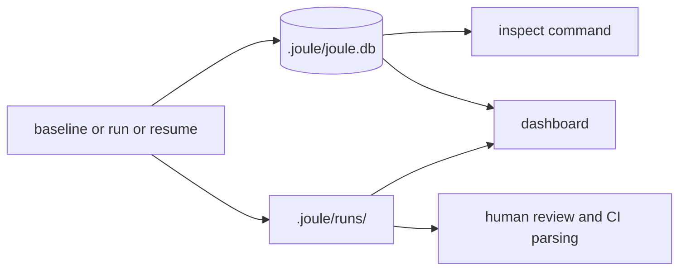

# Artifacts Guide

This guide answers: where should I look first when something succeeds, fails, or behaves unexpectedly?

## Artifact Flow



## Quick Lookup By Question

| Question | First place to check | Follow-up |
|---|---|---|
| Did a run initialize correctly? | `.joule.lock` | `.joule/runs/<run_id>/events.jsonl` |
| What was measured as baseline? | `baseline.json` | `baseline_analysis.json` |
| Why was a candidate rejected? | `inspect --candidate-id ...` | `events.jsonl` and candidate metadata |
| What changed for best candidate? | `best.patch` | `best_candidate.py` and `run_summary.json` |
| What happened in optimization flow? | `optimization_analysis.json` | `events.jsonl` |
| Can this candidate be applied? | candidate metadata `dependency_policy_state` | `apply` command response |
| Can I resume safely? | `checkpoint.json` and DB checkpoints | `resume --run-id ...` |

## Key Files Per Run

- `baseline.json`: full baseline measurement payload
- `baseline_analysis.json`: baseline summary and optional hotspot summary
- `run_summary.json`: high-level outcome with CI-oriented fields
- `optimization_analysis.json`: funnel, operator, and hotspot analysis
- `events.jsonl`: structured event timeline
- `dashboard.html`: static dashboard snapshot
- `checkpoint.json`: latest checkpoint payload for resumed runs
- `best.patch`: diff for best accepted candidate
- `best_candidate.py`: source for best accepted candidate
- `candidates/<candidate_id>/candidate.json`: per-candidate details (analysis mode)
- `candidates/<candidate_id>/candidate.py`: candidate source snapshot (analysis mode)

## Metadata And Schema Versions

Versioned fields to be aware of:

- candidate metadata includes `schema_version`
- surrogate decision payload includes `schema_version`
- search event detail payload includes `schema_version`

When parsing artifacts programmatically, read schema versions first and treat unknown fields as forward-compatible extensions.

## Recommended Inspection Sequence

1. Read `run_summary.json`.
2. If result is unexpected, open `optimization_analysis.json`.
3. Check `events.jsonl` for stage-level warning and rejection context.
4. Use `inspect --run-id ... --output json` for complete persisted state.
5. Review `best.patch` before any apply operation.

## Artifact Layout

```text
<project>/
├── .joule.lock
└── .joule/
    ├── joule.db
    └── runs/
        └── <run_id>/
            ├── baseline.json
            ├── baseline_analysis.json
            ├── run_summary.json
            ├── optimization_analysis.json
            ├── hotspots.json
            ├── events.jsonl
            ├── dashboard.html
            ├── checkpoint.json
            ├── best.patch
            ├── best_candidate.py
            └── candidates/
                └── <candidate_id>/
                    ├── candidate.json
                    └── candidate.py
```
