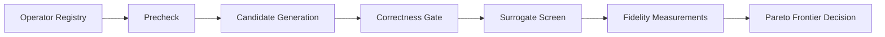

# Transformations Reference

This document explains how transformations are surfaced and evaluated in JOULE.

Source of truth for available operators is runtime output:

```bash
./joule transformations <project_or_file_path> --output human
./joule transformations <project_or_file_path> --output json
```

## Transformation Pipeline



## Tier Model

- `L` (syntactic): local structural rewrites
- `M` (semantic): broader semantic rewrites, often LLM-driven
- `H` (algorithmic): stronger structural or algorithm-level rewrites

## Operator Families

### Deterministic operators

Deterministic operators are AST-driven, precheck-gated rewrites intended to be predictable and testable.

Common categories include:

- loop and comprehension rewrites
- membership and container rewrites
- import and local-hoisting rewrites
- reduction and aggregation rewrites
- data-structure substitutions (`defaultdict`, `Counter`, `heapq`, `deque`)
- normalization rewrites (comparison, condition, boolean forms)

### Generative operators

Generative operators use prompt-guided LLM rewriting and remain bounded by correctness and measurement gates.

### Escape operator

Escape-only operators are invoked when search stagnation rules trigger fallback behavior.

## Snapshot Contract For Deterministic Output Shape

Deterministic output shape is locked by golden snapshots:

- [tests/golden/deterministic_operator_snapshots.json](../tests/golden/deterministic_operator_snapshots.json)
- [tests/test_transformer_golden_snapshots.py](../tests/test_transformer_golden_snapshots.py)

Run snapshot verification:

```bash
./.venv/bin/python -m pytest tests/test_transformer_golden_snapshots.py -q
```

## Operational Guidance

- Use `transformations --output json` in tooling where catalog stability matters.
- Treat runtime CLI output as authoritative over static docs for operator names.
- Use explicit workload selectors when evaluating higher-tier semantic/algorithmic candidates.
