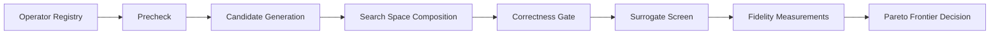

# Transformations Reference

This document explains how transformations are surfaced and evaluated in JOULE.

Source of truth for available operators is runtime output:

```bash
./joule transformations <project_or_file_path> --output human
./joule transformations <project_or_file_path> --output json
```

## Transformation Pipeline



## Search Space Composition

Generated candidates can be chained together using a bounded multi-hop composition strategy. This allows JOULE to explore multi-step refactorings (e.g., `ForLoopToComprehension` followed by `MapFilterFusion`) before hitting the surrogate evaluation and correctness gates. Composed candidates are evaluated alongside base candidates.

## Tier Model

| Tier | Label | Intent | Examples |
|------|-------|--------|----------|
| `L` | Syntactic | Fast, local structural rewrites; high precheck specificity | `ForLoopToComprehension`, `MapFilterFusion`, `FStringConversion` |
| `M` | Semantic | Broader rewrites that change data structures or caching contracts | `FunctoolsCacheInjection`, `LoopMembershipSetCache`, `DefaultDictSubstitution` |
| `H` | Algorithmic | Strong structural or algorithm-level rewrites | `MemoizationAddition` |

The default operator list in `default_deterministic_operators()` is ordered by tier (L → M → H) so precheck-gated operators are tried first at lowest cost.

## Operator Families

### Deterministic operators

Deterministic operators are AST-driven, precheck-gated rewrites intended to be predictable and testable.

Common categories include:

- **loop and comprehension rewrites** — `ForLoopToComprehension`, `MapFilterFusion`, `IteratorSubstitution`, `ReductionListCompToGenerator`
- **membership and container rewrites** — `ListToSetMembership`, `ContainerMembershipOperator`, `DictKeysMembershipElision`
- **caching and memoization** — `FunctoolsCacheInjection` *(new)*, `MemoizationAddition`, `LoopMembershipSetCache`
- **import and local-hoisting rewrites** — `LocalImportHoisting`, `LoopGlobalToLocalHoisting`
- **reduction and aggregation rewrites** — `StringConcatToJoin`, `SumListComprehensionOperator`, `JoinListCompToGenerator`
- **data-structure substitutions** — `DefaultDictSubstitution`, `CounterSubstitution`, `HeapNLargestSmallest`, `ListPopZeroToDeque`
- **normalization rewrites** — `ChainedComparisonFusion`, `IdentityCompareNormalization`, `ConstantConditionElision`, `NotInNormalization`, `ReturnBoolSimplification`

#### `FunctoolsCacheInjection` *(added)*

Injects `@functools.cache` on eligible pure module-level functions. Safety criteria:
- No `*args` / `**kwargs`
- No mutable default arguments
- No I/O side effects (`open`, `print`, etc.)
- No `global` / `nonlocal` / `yield` statements
- Returns a value (not `None`-only)

Targets smells: **C1** (redundant computation), **C8** (missing reuse).

#### `MapFilterFusion` *(added)*

Replaces explicit for-loop accumulations with built-in `map()` or `filter()` calls:

```python
# Before
result = []
for x in items:
    result.append(transform(x))

# After
result = list(map(transform, items))
```

Applied recursively inside nested blocks (for, if, while, with). Targets smells: **C3** (inefficient iteration), **C10** (language primitives).

### Generative operators

Generative operators use prompt-guided LLM rewriting and remain bounded by correctness and measurement gates.

#### Prompt Architecture *(updated)*

The LLM operator now uses a structured **system prompt + user prompt** architecture:

- **System prompt** — explicit rules: no `eval`/`exec`/global state, preserve semantics, strict JSON output.
- **User prompt sections**: `OPERATOR`, `TIER GUIDANCE` (per-tier Python heuristics), `DETECTED CODE SMELLS` (taxonomy hints injected from `smell_tagger`), `SEARCH CONTEXT` (parent ID, rejection history), `SOURCE TO OPTIMISE`.
- **Retry loop** — up to 2 retries with error feedback injected and temperature escalation: 0.0 → 0.2 → 0.4.
- **Syntax validation** — AST-checked before returning; failures trigger a retry with the specific error.

### Escape operator

Escape-only operators are invoked when search stagnation rules trigger fallback behavior.

## Snapshot Contract For Deterministic Output Shape

Deterministic output shape is locked by golden snapshots:

- [tests/golden/deterministic_operator_snapshots.json](../tests/golden/deterministic_operator_snapshots.json)
- [tests/test_transformer_golden_snapshots.py](../tests/test_transformer_golden_snapshots.py)

Run snapshot verification:

```bash
./.venv/bin/python -m pytest tests/test_transformer_golden_snapshots.py -q
```

## Operational Guidance

- Use `transformations --output json` in tooling where catalog stability matters.
- Treat runtime CLI output as authoritative over static docs for operator names.
- Use explicit workload selectors when evaluating higher-tier semantic/algorithmic candidates.
- When adding new features to `features.py`, always bump `FEATURE_SCHEMA_VERSION` in `types.py`.
- New deterministic operators should: declare `name`, `family`, `tier`, `targets_smells`; implement `_precheck_tree` and `generate`; add a golden snapshot entry.

## Code Smell Taxonomy

JOULE tags source code with smell categories from the Energy-Smells taxonomy. Tags influence operator selection (smell-overlap scoring bonus) and LLM prompt hints.

| Category | Description | Key Operators |
|----------|-------------|---------------|
| **C1** | Redundant computation | `FunctoolsCacheInjection`, `MemoizationAddition` |
| **C2** | Unnecessary call overhead | `LoopGlobalToLocalHoisting`, `LocalImportHoisting` |
| **C3** | Inefficient iteration | `ForLoopToComprehension`, `MapFilterFusion` |
| **C4** | Suboptimal control flow | `ConstantConditionElision`, `ReturnBoolSimplification` |
| **C5** | Suboptimal data structures | `ListToSetMembership`, `DefaultDictSubstitution`, `CounterSubstitution` |
| **C6** | Memory waste | `ListPopZeroToDeque`, `SeenSetForAppendDedup` |
| **C7** | Algorithmic inefficiency | `MemoizationAddition`, `HeapNLargestSmallest` |
| **C8** | Missing reuse / caching | `FunctoolsCacheInjection`, `LoopMembershipSetCache` |
| **C9** | I/O access patterns | LLM operators (buffering, lazy loading) |
| **C10** | Underused language primitives | `MapFilterFusion`, `EnumerateSubstitution`, `FStringConversion` |
| **C11** | Concurrency opportunity | LLM operators (ThreadPoolExecutor) |
| **C12** | Hardware locality | LLM operators (access pattern rewriting) |

## Operator Scoring

The operator registry ranks candidates using a multi-factor score:

```
score = UCB(attempts, reward)
      + (frontier_rate × FRONTIER_BONUS + depth_fit × DEPTH_FIT + phase_fit × PHASE_FIT) × ROI_weight
      + smell_overlap_bonus
      + ema_success_rate × 0.10
      + tier_phase_bonus
      - duplicate_penalty
      - correctness_failure_penalty
      - precheck_failure_penalty
```

Key points:
- **ROI multiplier** scales exploitation terms only (not the UCB exploration term), preserving fair exploration of new operators.
- **EMA success rate** (alpha=0.10) upweights recent outcomes over stale history.
- **Precheck failures** reset when the target function changes.
- **Tier-phase bonus** rewards Tier L in exploration, Tier M in exploitation, Tier H in confirmation.

## Surrogate Feature Schema

The surrogate models operate on a feature vector extracted from source code. **`FEATURE_SCHEMA_VERSION`** in `src/joule/surrogate/types.py` must be bumped whenever the feature vector dimensions change to invalidate stale warm-start observations.

Current version: **3** (39 features: 17 original + 16 Phase 1 smell indicators + 6 Phase 2 structural features)

Phase 2 additions:
- `cyclomatic_complexity` — branches + loops + try blocks + bool ops
- `loop_reduction_count` — AugAssign nodes inside loop bodies
- `is_pure_function` — no global/nonlocal, no I/O, no mutable defaults
- `name_reuse_ratio` — Load-ctx Names / (Store-ctx Names + args)
- `subscript_density` — subscript accesses / total node count
- `has_decorator` — any decorator present on any function/class

## Pareto Parent Selection

Frontier parent candidates are selected using a UCB formula:

```python
ucb_key = -weighted_score(metrics)                              # exploitation
         + UCB_BETA * sqrt(log(total_expansions + 1) / (n + 1)) # exploration
         ± generation_depth * 0.001                             # depth bias
```

`UCB_BETA = 1.0` (configurable on `ParetoFront` class). The `prefer_deeper` flag adds a positive depth bias in exploitation phases, negative in exploration.

